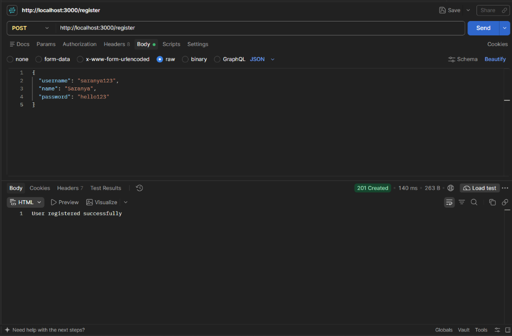
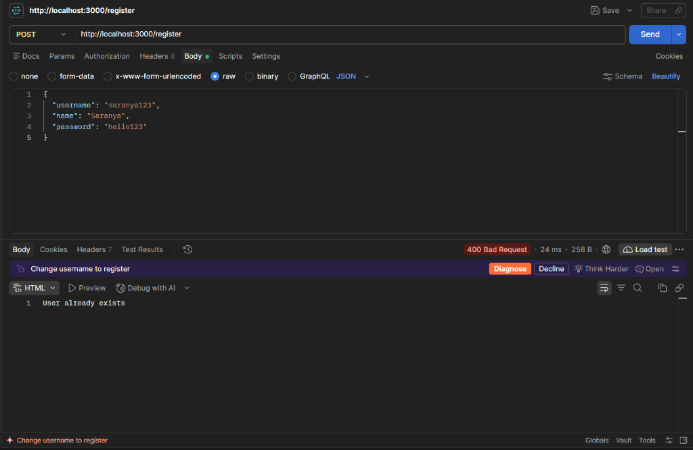
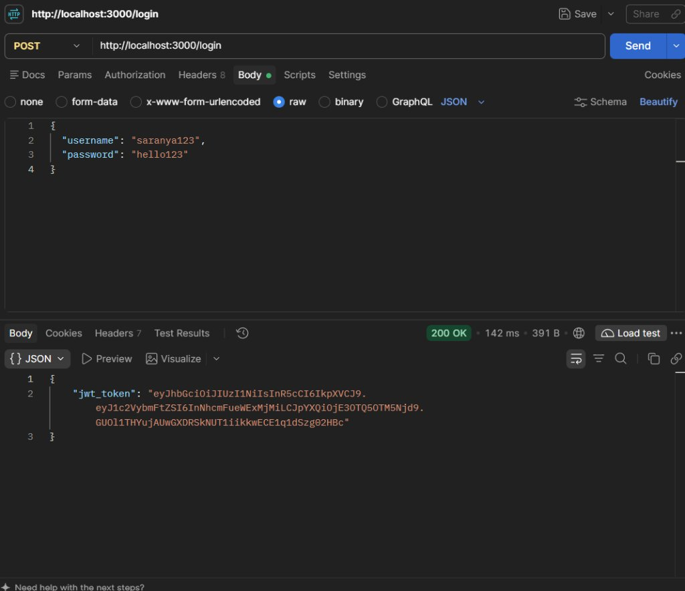
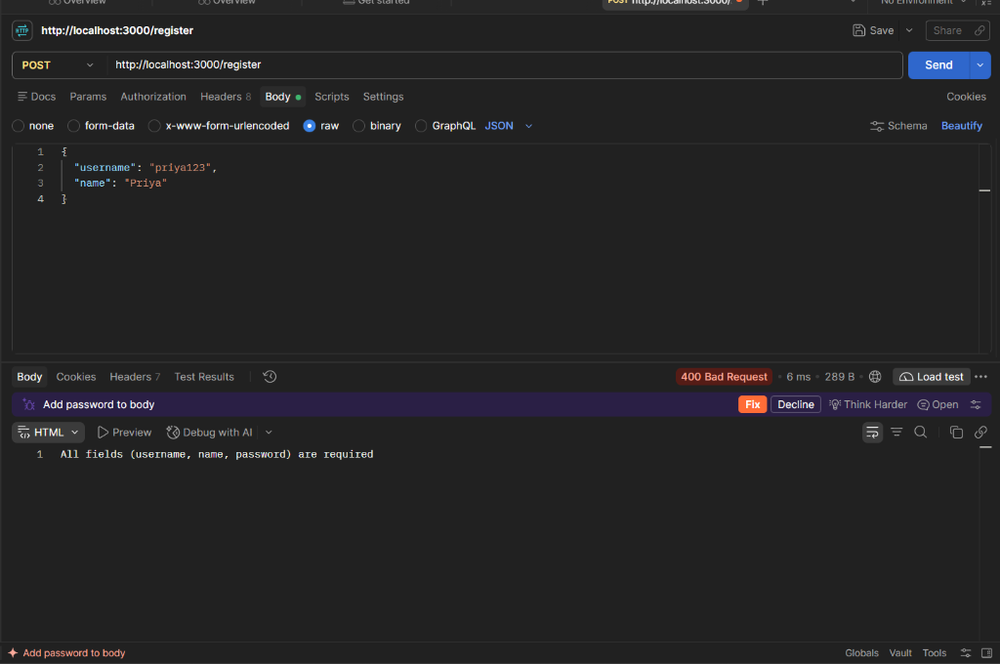
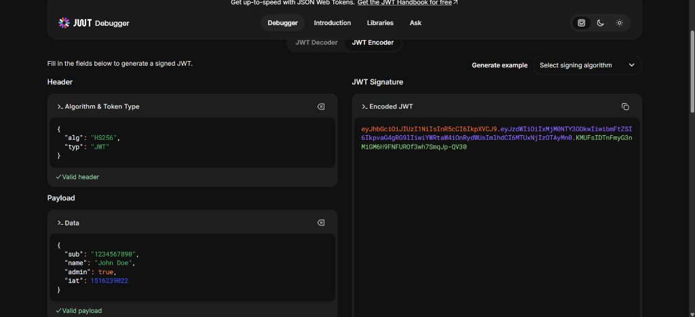

# Lab 4 – User Registration, Login and JWT Authentication

---

## 👤 Student Information
- **Name:** [J.Saranya]
- **Registration Number:** [252U1R6102]
- **Section / Branch:** [CSE / AIML]
- **Course:** Backend Development

---

## 1. 🎯 Objective
The objective of this lab is to understand and implement secure user authentication in a backend application. This includes:
- Building user registration with salted password hashing using `bcrypt`.
- Verifying user credentials securely during login.
- Generating and issuing JSON Web Tokens (JWT) for stateless authentication.
- Preventing common security vulnerabilities such as storing plain-text passwords and SQL injection.

---

## 2. 🛠️ Technologies Used
- **Node.js**: Asynchronous JavaScript runtime environment for executing server-side code.
- **Express.js**: Fast, minimalist web framework used to build RESTful APIs.
- **SQLite (`sqlite3`)**: Lightweight, file-based relational database management system.
- **bcrypt**: Cryptographic hashing library used to securely hash and salt user passwords.
- **jsonwebtoken (JWT)**: Library used to sign and verify JSON Web Tokens for authentication.
- **Postman**: API client used to test HTTP requests, inspect status codes, and verify response payloads.

---

## 3. 📁 Project Structure

```
lab-04/
├── database.js
├── server.js
├── package.json
├── package-lock.json
├── screenshots/
└── README.md
```

> **Important Note:** `node_modules`, `.env`, and any database file containing real personal information should not be uploaded to GitHub. These files are excluded via `.gitignore`.

---

## 4. ⚙️ Installation and Setup

### Prerequisites
Ensure Node.js and npm are installed on your computer.

### Steps to Run the Project
1. Open your terminal and navigate to the `lab-04` directory:
   ```bash
   cd lab-04
   ```

2. Install the required dependencies:
   ```bash
   npm install
   ```

3. Start the application server:
   ```bash
   node server.js
   ```

4. The server will start and listen on port 3000:
   ```text
   Connected to SQLite database: users.db
   Users table initialized successfully.
   Server running at http://localhost:3000/
   ```

---

## 5. 🗄️ Database Details

The application connects to a file-based SQLite database named `users.db`. The table is initialized automatically upon application startup by `database.js`.

### Table: `users`
| Column Name | Data Type | Constraints | Description |
|---|---|---|---|
| `username` | `TEXT` | `UNIQUE NOT NULL` | Unique identifier used for user login |
| `name` | `TEXT` | `NOT NULL` | Display or full name of the user |
| `password` | `TEXT` | `NOT NULL` | Securely hashed password (bcrypt hash) |

> **Security Note:** Passwords are **never stored in plain text**. During registration, the password is processed using `bcrypt.hash(password, 10)` with 10 salt rounds before being saved to SQLite.

---

## 6. 🚀 API Endpoints

| HTTP Method | Endpoint | Description | Request Body Format | Success Status |
|---|---|---|---|---|
| `POST` | `/register` | Registers a new user with a hashed password | JSON: `{ "username", "name", "password" }` | `201 Created` |
| `POST` | `/login` | Authenticates credentials and returns a JWT | JSON: `{ "username", "password" }` | `200 OK` |

---

## 7. 🧪 Testing Results

All API scenarios were tested using Postman.

1. **Registration Successful:**
   - Sending valid `username`, `name`, and `password` to `POST /register`.
   - **Result:** Returns status `201 Created` with `"User registered successfully"`. Passwords are stored as bcrypt hashes in the SQLite database.

2. **Duplicate Username Rejected:**
   - Attempting to register with an already existing `username`.
   - **Result:** Returns status `400 Bad Request` with `"User already exists"`.

3. **Missing Registration Fields Rejected:**
   - Sending a registration request with any missing field (e.g., omitting `password`).
   - **Result:** Returns status `400 Bad Request` with `"All fields (username, name, password) are required"`.

4. **Login Successful with JWT Token:**
   - Sending correct `username` and `password` to `POST /login`.
   - **Result:** Returns status `200 OK` with a JSON response containing `{ "jwt_token": "<token_string>" }`.

5. **Invalid Username and Password Rejected:**
   - **Invalid Username:** Supplying a username not present in the database returns status `400 Bad Request` with `"Invalid user"`.
   - **Invalid Password:** Supplying an incorrect password for an existing user returns status `400 Bad Request` with `"Invalid password"`.

---

## 8. 🔑 JWT Verification

After receiving the `jwt_token` from a successful login, the token was decoded and inspected using [jwt.io](https://jwt.io/):

- **Header:** Specifies the token type (`JWT`) and signing algorithm (`HS256`).
- **Payload:** Contains the `username` and automatically generated `iat` timestamp.
- **Confidentiality:** Confirmed that neither plain-text passwords nor password hashes are exposed in the token payload.

---

## 9. 📸 Screenshots

### Registration Success
*Shows status 201 Created and success message when registering a new user.*


### Registration Failure
*Shows status 400 Bad Request when attempting duplicate registration or missing fields.*


### Login Success
*Shows status 200 OK and the returned jwt_token upon valid credentials.*


### Login Failure
*Shows status 400 Bad Request for invalid username or incorrect password.*


### JWT Decoding (jwt.io)
*Shows the decoded token payload on jwt.io containing only the username.*


---

## 10. 🏁 Conclusion

In this lab, a secure backend authentication system was successfully built and tested using Node.js, Express.js, SQLite, bcrypt, and jsonwebtoken:
- Passwords are securely hashed with salts using `bcrypt` to prevent plain-text exposure.
- Parameterized SQL queries prevent SQL injection attacks.
- JSON Web Tokens provide stateless authentication without storing active session tokens in the database.
- Input validation and consistent HTTP status codes ensure clean and predictable API behavior.
